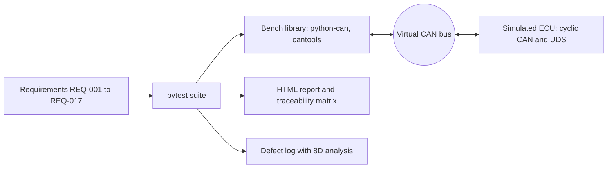

# Automated ECU Test Bench (CAN / UDS) with Python and pytest


A software test bench that verifies a simulated automotive ECU (coolant temperature and fan controller) over CAN and UDS.
It covers requirements, test design, automation, fault injection, traceability and defect analysis.

## Objective
Show a complete validation workflow: write measurable requirements, design tests, automate them, inject faults,
trace results back to requirements, and document defects with root cause analysis.

## Architecture


| Folder | Content |
|---|---|
| `requirements/` | Requirements table |
| `dbc/` | CAN database (ENGINE_STATUS 0x100, SENSOR_INPUT 0x300) |
| `ecu_sim/` | Simulated ECU and UDS server (0x10, 0x19, 0x22, 0x27) |
| `bench/` | Test bench library: helpers, UDS client, load generator |
| `tests/` | pytest suite |
| `reports/` | HTML report and traceability matrix |
| `docs/` | Defect log and template |

## Test design
Boundary values, equivalence classes, state-transition tests (fan hysteresis, diagnostic sessions, security access),
timing tests (cycle time, response time), negative tests and fault injection (wrong DLC, input frame loss,
bus load, malformed ISO-TP frames). Self-check tests prove the bench detects a slow or silent ECU.

## How to run
```bash
python3 -m venv .venv && source .venv/bin/activate
pip install -r requirements.txt
pytest -v
pytest --html=reports/report.html --self-contained-html
```
Linux or WSL. The virtual CAN bus is in memory, so no kernel CAN support is needed.

## Results
_Replace with your own numbers from your last run._

| Item | Value |
|---|---|
| Requirements | 17 |
| Tests | _N_ |
| Passed | _N_ |
| Defects found and documented | _N_ (see `docs/defects.md`) |

## Limitations
- Virtual bus only: no electrical layer, no bus arbitration, no real hardware timing.
- Timing is measured in Python on a general-purpose OS, so jitter is higher than on a real ECU.
- UDS uses single-frame ISO-TP only; multi-frame transfer is not covered.
- The ECU is a software model, not production firmware.

## Roadmap
1. Model-based design of the controller in MATLAB/Simulink (MIL/SIL).
2. Real firmware on STM32 (bare metal, then FreeRTOS), tested with the same bench over a real CAN adapter.
